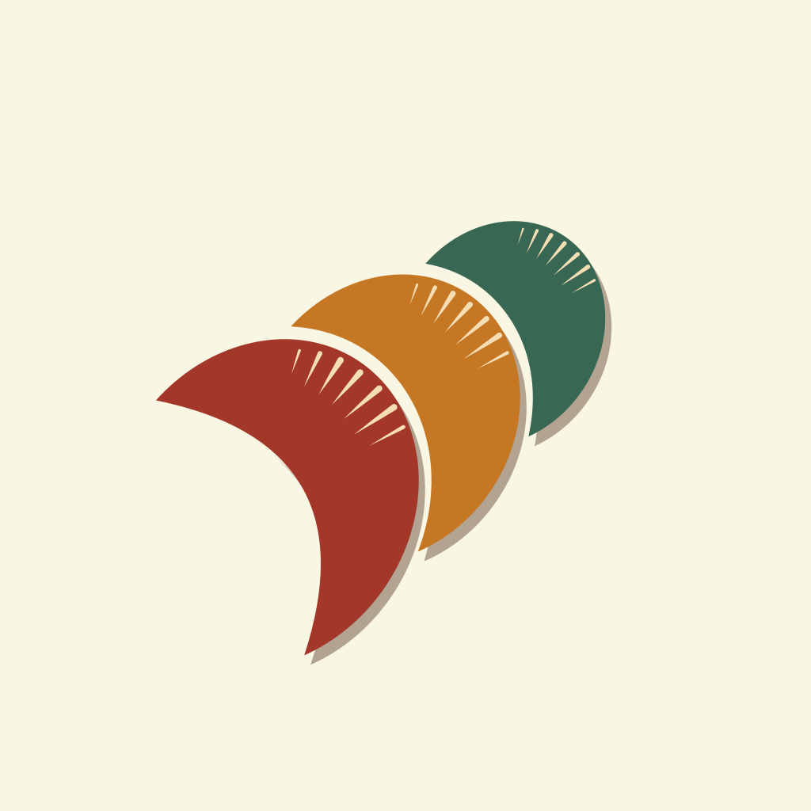

# The Jin icon



The approved mark is [`assets/jin-icon.svg`](../assets/jin-icon.svg). This file records how it is
built, so the SVG can be reconstructed from the recipe alone. The executable form of the recipe is
[`tools/make_icon.py`](../tools/make_icon.py); it needs no dependencies and writes the same geometry.

## The idea

Three overlapping scale shards — the repeating woven unit behind the name 锦 (brocade). Each shard is
a crescent: a strongly curved outer rim and a shallow inner scoop, with a comb of cream spines near
the rim. The three shards overlap like roof tiles; the cream lines between them are revealed
background, not strokes. The palette is warm silk on paper; the shadows are flat and hard, not
lighting.

The mark is **not traced** from the reference image. The reference supplies proportions and colours;
the outline is rebuilt from one ellipse arc and one quadratic Bezier per shard, then idealised.

## Plate and palette

1024 × 1024, full-bleed.

| Role | Value |
| --- | --- |
| Paper plate, the 16 px reveals | `#F9F7E4` |
| Red shard | `#A33729` |
| Orange shard | `#C57724` |
| Green shard | `#386754` |
| Spines | `#F5DEB4` |
| Shadow | `#4B2817` at 40% |

## One shard

Work in the shard's local frame: `A = (0, 0)` is the upper tip, `B = (0, 372.4)` the lower tip, `+y`
runs down the chord and `+x` points into the belly.

* **Outer rim** — one elliptical arc:
  `A 218 187 -25 1 1 0 372.4` from `A` to `B`.
  `large-arc = 1` is essential: the rim is the *long* way around a major arc, which is what makes the
  crescent belly. `rx = 218`, `ry = 187`, rotation `-25°`.
* **Inner edge** — one three-point quadratic Bezier from `B` back to `A`, control point
  `(208.6, 186.1)`. It bows into the belly and makes the scoop. The control is not on the chord; its
  x is 0.56·L, its y is half the chord.
* **Body**:
  `M0 0 A218 187 -25 1 1 0 372.4 Q208.6 186.1 0 0 Z`.

### Spines

Seven tapered blades sit just inside the rim, one per measured position from the reference. They are
cream, clipped to the body. Each is a teardrop: a pointed inner tip, a rounded outer end, two slightly
bowed sides. Positions are fractions of `L` in the local frame.

| Outer end | Inner point | Base width |
| --- | --- | --- |
| (0.502, 0.102) | (0.442, 0.154) | 0.0085 |
| (0.554, 0.147) | (0.457, 0.213) | 0.0145 |
| (0.600, 0.202) | (0.486, 0.261) | 0.0194 |
| (0.636, 0.270) | (0.508, 0.313) | 0.0194 |
| (0.664, 0.348) | (0.518, 0.375) | 0.0189 |
| (0.676, 0.427) | (0.521, 0.438) | 0.0194 |
| (0.673, 0.500) | (0.549, 0.497) | 0.0120 |

The blade code multiplies the width by 1.12 and bows the sides by 0.30·width; that compensates for the
soft edges of the reference's cream marks.

## The three shards

Draw order: green, orange, red. Each group is `translate(A) rotate(θ)`; the path itself is
pre-scaled, so no `scale()` appears in the SVG.

| Shard | A | θ | Scale | Inner control (local) |
| --- | --- | --- | --- | --- |
| green | (559.30, 299.46) | −30.749° | 0.68221 | (111.48, 124.48) |
| orange | (389.24, 378.90) | −29.454° | 0.87635 | (170.97, 157.58) |
| red | (219.00, 472.00) | −30.200° | 1.00000 | (208.60, 186.10) |

The radii and tip positions are the base values multiplied by the shard's scale: e.g. the orange rim is
`A 191.04 163.88 -25 …` and its chord is `326.35`.

The back shards are deliberately **smaller** than a naive copy of the reference. They were placed so
their tips land on a 16 px offset of the shard in front, which shortened their chords: orange 0.876,
green 0.682 instead of 0.897 / 0.728.

### Constant 16 px reveal

There is no gap geometry between the shards. Each shard draws its rim twice: first a
`stroke="#F9F7E4"` of **32 px** (16 px outside the colour edge), then its filled body. The back shard
is pulled close enough that its inner edge lies inside that 32 px band, so the visible separation is
exactly 16 px from the front's colour edge to the back's colour edge. The band is a background stroke,
not a mask, which is why the gap survives at every scale.

The derivation of the back transforms:

1. Fit the red outer rim to an ellipse (rms < 1 px) and measure its tips; `L = 372.4`.
2. Project the next shard's original two tips onto that rim.
3. Offset both projected points 16 px outward along the rim normal and fit a quadratic to the offset
   curve; that becomes the shard's inner control.
4. Apply the similarity that maps the shard's original tip pair to the offset pair. This sets the
   rotation and the reduced scale.
5. Repeat with the orange as the front for the green.

## Hard shadow

A duplicate of the shard body, `#4B2817` at 40%, offset `(+8, +12)` in screen space, drawn after the
cream reveal and before the fill. No blur: the 2D edge is the point. The offset is rotated into each
group's local frame so the light direction is the same for all three.

The red shard's shadow is split into its own group and masked by `redBoxHole`: a 247 × 136 rectangle at
(139, 458) in the artwork's coordinate space, feathered 10 px, is cut from the shadow. This removes the
shadow from the red's left tip area while leaving the rest of the shadow untouched. It is an approved
part of the mark, not a rendering accident; the feather avoids a hard grey step at the cut.

## Optical centre

The icon is not centred by its bounding box. It is centred by ink mass, the way an app icon is checked:

1. Render at 1024 on the cream plate.
2. Weight each pixel by `max(0, L_bg − L_pixel)` (luminance of the plate minus the pixel; the uniform
   plate contributes zero, the shards and shadow contribute their visual weight).
3. Compute the weighted centroid; translate all artwork so it lands on (512, 512).

The final translation is `translate(-22.12, 33.49)`. The measured centroid is (512.0, 512.0). A
Gaussian blur preserves the first moment, so the blurred image's centre is the same point. This makes
the plate deliberately asymmetric: the top margin is larger than the bottom.

## Regenerating

```bash
python tools/make_icon.py            # writes assets/jin-icon.svg
```

Rasterise with a headless browser or the Tauri CLI, for example:

```bash
msedge --headless=new --window-size=1024,1024 \
  --screenshot=assets/jin-icon-1024.png \
  file:///<repo>/assets/jin-icon.svg
```

`assets/jin-icon-1024.png` is the input for `pnpm exec tauri icon`; the gallery's `public/jin-icon.svg`
is a copy of the same file for the browser favicon.

## Checks

* Both reveals measure 15–17 px; the median is 16.
* The red shadow is absent inside the hole rectangle, including the tip, and hard-edged outside it.
* The luminance centroid of a 1024 render is (512, 512) within 0.1 px.
* The three outer rims remain single elliptical arcs and the three inner edges remain single
  quadratics. Do not replace them with traced polylines.
